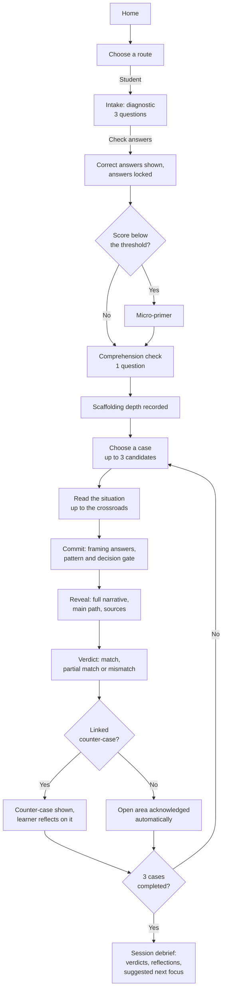
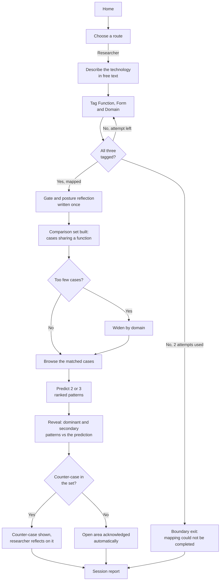

# EssentialTech Dual-Use

## Stack

| Layer | Technology |
| --- | --- |
| Backend | Python, FastAPI, SQLModel, Alembic, PostgreSQL |
| Frontend | Node.js, Quasar v2, Vue 3, Pinia, Vue Router, vue-i18n, TypeScript |
| Tooling | uv, npm, Lefthook, Commitlint, Ruff, ty, ESLint, Prettier |
| CI/CD | GitHub Actions (checks, tests, deploy) |
| Containers | Docker, docker-compose (PostgreSQL) |

## Learning flow

A learner picks one of two routes on `/start`. Both end in a report, and both
ask for a decision **before** the answer is shown: the case's main path never
reaches the browser until the reveal.

### Student route

Up to three cases per session, one decision at a time.



- **Intake:** the answer key stays on the server. "Check answers" submits the
  answers, and the response carries the correct options; the page shows them
  with the answers locked. A wrong answer teaches but never blocks.
- **Placeholders:** the intake items, the threshold (2 of 3) and the rule that
  derives the scaffolding depth are stand-ins for content not yet written
  (`backend/api/content/intake_key.py`). Nothing reads the scaffolding depth
  yet.
- **Reveal:** computed once and stored, so the verdict never changes if the
  learner asks again.
- **Cases:** a case the learner has already met, in any of their sessions, is
  not offered again.

### Researcher route

One technology per session, compared against the curated cases.



- **Tagging:** two attempts in total. Running out is a normal ending, not an
  error: the session goes straight to its report.
- **Prediction:** written once; the reveal compares it with the pattern
  distribution of the comparison set. If no case in the set carries a tagged
  pattern, the report says so (low activation) instead of naming a dominant
  one.

## Requirements

- [uv](https://docs.astral.sh/uv/getting-started/installation/) Python package and project manager
- [npm](https://docs.npmjs.com/) Node.js package manager
- [Docker](https://docs.docker.com/) with Docker Compose
- Make

## Deploying locally

Clone the repository:

```bash
git clone https://github.com/EPFL-ENAC/esstech-dualuse.git
cd esstech-dualuse
```

Setup your environment by running:

```bash
make install
```

This step installs the backend and frontend dependencies and creates a local `.env`
file from `.env.example` if none exists. The backend installs exactly the versions
pinned in `backend/uv.lock` (`uv sync --locked`), the same ones CI and the Docker
image use. To upgrade a library, run `uv lock --upgrade-package <name>` in
`backend/`, check that the tests and `make typecheck` still pass, and commit the
new lock file.

### Backend

In one shell, run:

```bash
make run-db
make db-upgrade
make db-seed
make run-backend
```

The interactive API documentation will be available at
[http://localhost:8000/docs](http://localhost:8000/docs).

The health check endpoint is at [http://localhost:8000/healthz](http://localhost:8000/healthz).

The curated cases live only in `backend/scripts/seed_cases.py`. `make db-seed`
loads them by title, so it is safe to run again. The Docker image does the same
on every start (`backend/start.sh`, after the migrations), which means edits to
the cases are made in that file, not in the database: changes made directly in
the database are overwritten at the next start.

### Frontend

In another shell, run:

```bash
make run-frontend
```

The website will be available at [http://localhost:9000](http://localhost:9000).

## Database migrations

The backend uses [Alembic](https://alembic.sqlalchemy.org/) for schema migrations.
Manage them through the `backend/Makefile` (forwarded from the root `Makefile`):

```bash
# Apply all pending migrations to the database (start `make run-db` first)
make db-upgrade

# Roll back the last migration
make db-downgrade

# Autogenerate a migration revision from your SQLModel model changes
make db-revision name="describe the change"
```

The `name` argument in `db-revision` is required and becomes the migration message.

## Development

### Backend

The backend is a FastAPI application under `backend/api/`. The project layout is:

| Path | Purpose |
| --- | --- |
| `backend/api/main.py` | Application and router registration |
| `backend/api/config.py` | Pydantic settings loaded from `.env` |
| `backend/api/db.py` | Async engine, session dependency, startup schema check |
| `backend/api/dependencies.py` | Learner identity and session/encounter ownership checks |
| `backend/api/cookies.py` | Cookie attributes shared by every cookie the API sets |
| `backend/api/content/` | Intake answer key and scoring rules (placeholder content) |
| `backend/api/models/` | SQLModel table models |
| `backend/api/services/` | Business logic |
| `backend/api/views/` | FastAPI routers (endpoints) |
| `backend/migrations/` | Alembic migration scripts |
| `backend/scripts/` | Case seeding (`make db-seed`) and the e2e database reset |
| `backend/tests/` | pytest test suite |

To run backend checks:

```bash
cd backend
make test      # run pytest
make lint      # sort imports with ruff
make format    # run ruff format
make typecheck # run ty
```

### Frontend

The frontend is a Quasar v2 SPA under `frontend/src/`. The project layout is:

| Path | Purpose |
| --- | --- |
| `frontend/src/api/` | Typed API clients and the taxonomy shared with the backend |
| `frontend/src/content/` | Static learner-facing content and option lists |
| `frontend/src/composables/` | Shared page logic (error state, reveal → contrast sequence) |
| `frontend/src/router/` | Vue Router routes |
| `frontend/src/layouts/` | Page layouts |
| `frontend/src/pages/` | Page components |
| `frontend/src/components/` | Reusable components |
| `frontend/src/stores/` | Pinia stores |
| `frontend/src/boot/` | Quasar boot files |
| `frontend/src/css/` | Global styles; `epfl/tokens/` holds the EPFL design tokens, copied unchanged from the [epfl-design skill](https://github.com/EPFL-ENAC/epfl-design-skill) |
| `frontend/src/i18n/` | vue-i18n locale messages |

To run frontend checks:

```bash
cd frontend
npm run lint      # run eslint
npm run format    # run prettier
npm run typecheck # run vue-tsc
```

End-to-end tests (Playwright) start their own backend and frontend against a
dedicated `app_e2e` database, which they reset, migrate and seed first. Start
the database (`make run-db` from the repo root), stop any running dev servers,
then:

```bash
cd frontend
npm run test:e2e
```

### Google sign-in

Google OAuth is optional. Without `GOOGLE_CLIENT_ID` and `GOOGLE_CLIENT_SECRET`
in `.env`, `/auth/google/*` answers 503 and learners are identified by a
pseudonymous `dev_learner_id` cookie instead.

### Pre-commit hooks

This project uses [Lefthook](https://lefthook.dev/) for pre-commit and commit-msg hooks
(typecheck, lint, format, codespell, and commitlint). They run automatically on commit.

You can run all hooks manually without committing:

```bash
make lint
```

Commit messages must follow the
[Conventional Commits](https://www.conventionalcommits.org/) convention.

## CI/CD

GitHub Actions run on every push and pull request:

- `.github/workflows/checks.yml`: lint and typecheck for backend and frontend.
- `.github/workflows/tests.yml`: run the backend test suite.
- `.github/workflows/deploy.yml`: build, push, and deploy on `dev`/`stage` pushes and
  version tags. The target org/repo must be set in the workflow inputs before use.

## License

All rights reserved.
